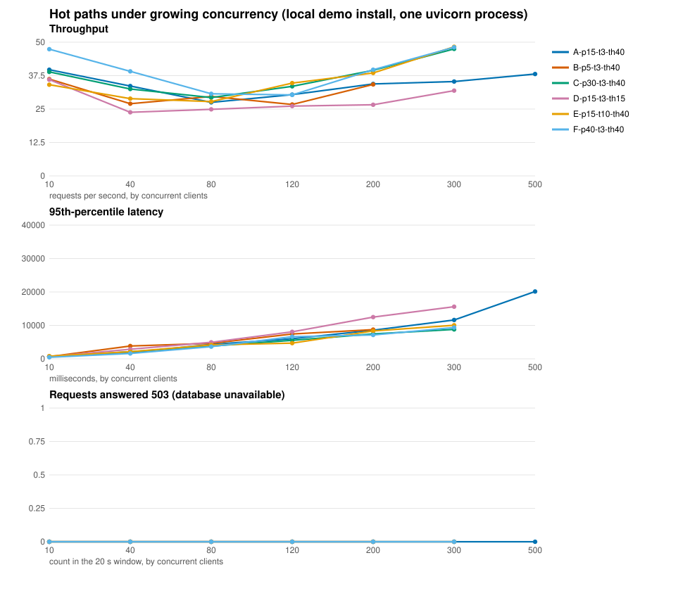
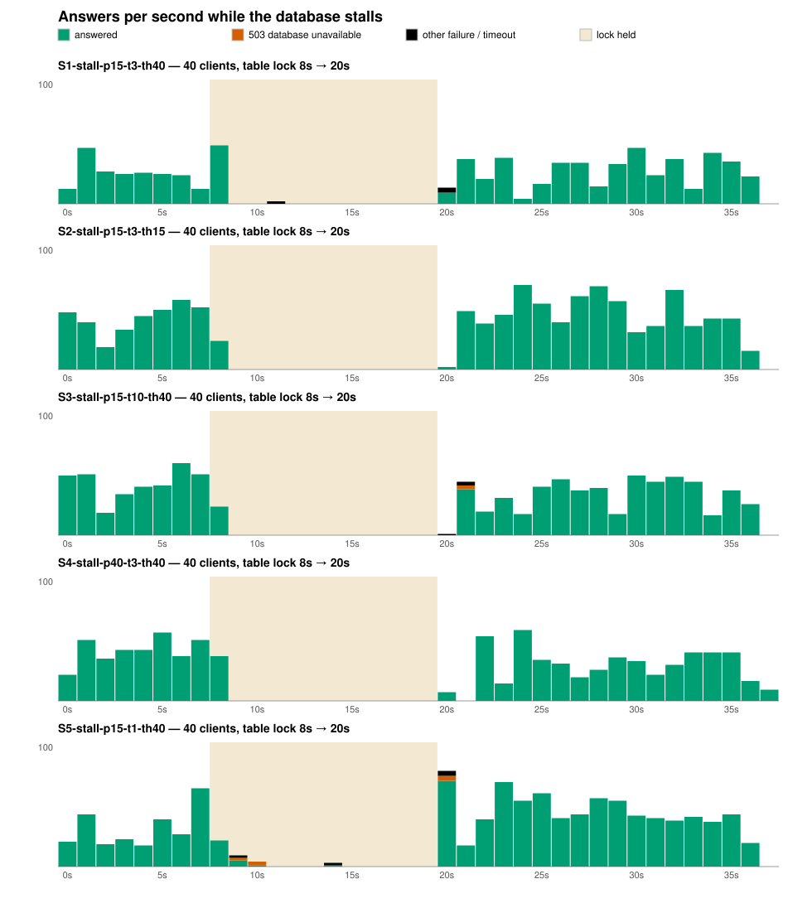

# Capacity: the database pool, the thread limit, and one process

Measured 2026-10-25 on a local copy of the demo installation (own app container + own Postgres; never the
live site, never the municipal installation). Re-run it with `scripts/load_hot_paths.py` (recipe at the end).

## Verdict

- **At the shipped defaults (15 connections, 3 s wait, 40 threads) nothing returns 503 under load.** Not at 120
  concurrent clients, not at 500. Latency grows, errors do not. The limit is the CPU of the single Python process
  (about 30–50 requests per second on the heaviest realistic mix), not the pool: the pool saturates (15 of 15
  connections in use from 20 clients up) but connections are held for milliseconds, so waiting for one never
  reaches 3 s.
- Changing the pool (5, 15, 30, 40), the wait (1, 3, 10 s) or the thread limit (15, 40) did not change throughput
  or error counts beyond the run-to-run noise of a shared machine (±30 %). **The defaults stay.** The three numbers
  are now settings (`TURNOS_DB_POOL`, `TURNOS_DB_POOL_TIMEOUT`, `TURNOS_THREADPOOL_SIZE`) with the old values as
  defaults, so an installation can change them without a code change.
- **503 happens when the database stops answering**, not when traffic is high: while a table lock held every
  panel request, nothing was answered for the length of the stall whatever the settings, and the 503s that did
  appear were few (0–9 in 12 s). No setting rescues that; only the database side does (see «If the stall is the
  real risk»).
- **Found and fixed:** a handler without its own `try/except` for `DbUnavailable` answered the plain text
  `500 Internal Server Error` when no connection freed up (`GET /api/admin/patients` under load). One app-level
  handler now gives every such route the 503 `{"error": "base de datos no disponible"}` that the other routes
  already send, plus `Retry-After: 3`, and the reason is written to the log (it tells «pool busy» from «database
  broken»). Routes that catch the exception keep answering their own way. An HTML screen that hits it during an
  outage shows that JSON instead of the plain-text 500.
- **One process is enough for a hospital; a second one is not free.** See «One process or two».

## What was measured

Setup: Postgres 16 and the app image built from this repository (`Dockerfile`), demo mode with the seeded demo
data (41 patients, 180 requests, today's queue, ~2,700 free slots); app container limited to 2 CPUs, Postgres to 2,
on a 16-core shared build machine that was running other CI jobs at the same time (so absolute numbers are
pessimistic and noisy; compare shapes, not decimals). Closed-loop clients with no think time: the load is the
number of clients, which is harsher than people clicking.

What one client does, weighted: `queue` 25 % (`GET /api/admin/day-queue`), `slots_patient` 20 %
(`GET /api/service-slots/<id>`), `panel` 25 % (patients list, requests list and the `/admin/cola` screen),
`slots_admin` 10 %, `login` 10 % (`POST /api/admin/login`, password hashing), `booking` 10 %
(`POST /api/admin/appointments`, a real write). Costs for one client alone: queue 15 ms, `/admin/cola` 28 ms,
patients 8 ms, requests list 72 ms, patient slots 3 ms.

### Growing concurrency (20 s per level)



Selected rows (requests per second / 95th-percentile latency; no run had a single 503 or 5xx):

| clients | A: pool 15, wait 3 s, 40 threads (default) | B: pool 5 | C: pool 30 | D: 15 threads | E: wait 10 s | F: pool 40 |
|---:|---:|---:|---:|---:|---:|---:|
| 10 | 40 / 0.6 s | 36 / 0.7 s | 39 / 0.7 s | 36 / 0.7 s | 34 / 0.8 s | 47 / 0.5 s |
| 40 | 34 / 1.9 s | 27 / 3.8 s | 33 / 2.1 s | 24 / 2.9 s | 29 / 2.1 s | 39 / 1.6 s |
| 120 | 30 / 6.0 s | 27 / 7.4 s | 34 / 5.5 s | 26 / 8.1 s | 35 / 4.7 s | 30 / 6.6 s |
| 300 | 35 / 11.6 s | – | 48 / 8.8 s | 32 / 15.6 s | 48 / 10.1 s | 48 / 9.4 s |
| 500 | 38 / 20.2 s | – | – | – | – | – |

Connections in use (sampled from Postgres): 10 at 10 clients, 15 (the whole pool) from 20 clients up. A quieter
earlier run of the default reached 52 requests per second at 120 clients with a 3.2 s p95.

How to read it: from about 20 clients every extra client only waits in line for the process's CPU (latency ≈
clients ÷ throughput), and the pool never becomes the queue. A hospital desk is nowhere near this: 50 staff
clicking once every 3 seconds is about 17 requests per second.

### While the database stalls (a table locked for 12 s, 40 clients)



An `ACCESS EXCLUSIVE` lock on `operators` (read by every panel request's permission check) from second 8 to 20.

| setting | 503 | other 5xx / failed | what the chart shows |
|---|---:|---:|---|
| S1 default (15 / 3 s / 40) | 0 | 6 | nothing answered for the whole lock, then a clean recovery |
| S2 15 threads | 0 | 0 | same |
| S3 wait 10 s | 3 | 4 | same, a few 503 when the 10 s wait runs out |
| S4 pool 40 | 0 | 0 | same (up to 40 connections in use, all waiting) |
| S5 wait 1 s | 9 | 8 | same, a few more 503 sooner |

The lock, not the pool, decides: every request that needs the table waits for it. Recovery was immediate when the
lock was released in every configuration. The «failed» column is the 500s fixed above plus client-side resets.

## The settings

| variable | default | meaning |
|---|---:|---|
| `TURNOS_DB_POOL` | 15 | connections the process keeps (per process) |
| `TURNOS_DB_POOL_TIMEOUT` | 3 | seconds a request waits for a free connection before the 503 (a value that is unreadable, not finite or ≤ 0 falls back to 3; above 60 it is capped at 60) |
| `TURNOS_THREADPOOL_SIZE` | 40 | worker threads that run the synchronous database code (AnyIO's own default, now explicit) |

The process prints the effective values at boot (`Concurrencia: 40 hilos, pool de 15 conexiones, espera de 3 s …`).
Rules of thumb: more threads than connections is fine because requests spend most of their time outside the
database; only a database that holds connections for about 1 s each (a stall) makes the surplus threads wait the
full 3 s. Postgres' own `max_connections` (100 by default) must stay above processes × `TURNOS_DB_POOL` + the queue
worker's pool + one connection per open live-queue (SSE) tab.

### The stall: the web process's database limits (2026-10-28)

What shortens a stall is a `lock_timeout` and a `statement_timeout`, so a stuck migration or runaway query fails
fast instead of holding every pooled connection. The web process now sets both on every connection of its pool
(`db.enable_web_timeouts()`, called only by `asgi_main.py` when it is the process entrypoint; `_configure_web_connection`
runs on each connection the pool opens):

| variable | default | meaning |
|---|---:|---|
| `TURNOS_DB_STATEMENT_TIMEOUT` | 30 | seconds a statement of the web process may run (`0` = no limit; unreadable or negative falls back to 30; capped at 600) |
| `TURNOS_DB_LOCK_TIMEOUT` | 5 | seconds a statement of the web process may wait for a lock (same rules) |

The boot prints them (`Límites de la base (proceso web): consulta 30 s, espera de bloqueo 5 s.`). A cut statement
raises `db.DbTimeout`, a `DbUnavailable`: every route that already answers 503 for a database that does not answer
answers it for this too, and the app-level handler gives the rest the same 503 `{"error": "base de datos no
disponible"}` with `Retry-After: 3`; the log line says which limit it was.

A route that already catches `DbUnavailable` keeps its own answer: the staff permission read falls back to the
role-based gate (owner decision 2026-09-12, `app/auth/admin_auth.py`), `/admin/cola` renders its empty «server unavailable»
shape. So during a lock stall a request that touches the locked table waits the 5 s and then answers that way, instead
of waiting for the whole stall.

**What takes no limit from this setting** (it keeps the server's or role's own default, normally none): migrations (Alembic opens its own connection), the schema bootstrap on the first
connection (`db.without_timeouts`: it waits for another replica's migration lock on purpose), the backup (`pg_dump`
and its snapshot connection are their own connections; the journal's session lock waits for another backup under
`without_timeouts`), the queue worker (`worker.py` is a separate process that never enables them, even though it
inherits the variables), the live-queue listener and every script. The role-level alternative (`ALTER ROLE … SET`) is
not used: it would apply to all of them.

**Why 30 s and 5 s.** Measured 2026-10-28 on a local copy of the demo grown ×300 (97,825 requests, 28,294 accounts,
100,025 searches; Postgres 16, `pg_stat_statements`), 51 panel and report routes driven through the app (50 answered
200, `appointment-slots` 400 for want of parameters), two runs, the second with the limits on and the lifespan running:
the longest single statement took **103 ms / 121 ms** (the monthly series of the reports), the longest request
**724 ms / 768 ms** (the 3.8 MB `requests.csv`), a full `pg_dump` of the 9.5 MB result 0.65 s. Production is far
smaller (a 735 KB nightly dump; its database was not queried, the server gives read access to status, logs and the
backup list only). 30 s is ~250× the longest statement and ~40× the longest request, and shorter than
the 60 s a proxy waits; a legitimate lock wait is milliseconds (row, advisory and slot locks), 5 s is above the 3 s a
request waits for a pooled connection. Through the real entrypoint (`asgi_main.py`, in-process daemons running: the
housekeeping sweep and the order-retention sweep ran at boot on that data) the standard load mix at 40 and 120 clients
for 20 s each, writes included, gave 0 × 503 and 0 × 5xx. With `operators` locked for 14 s the first request to touch
it answered after 5.0 s with the limits on and after 13.9 s with both set to `0`. If a report ever needs longer, raise `TURNOS_DB_STATEMENT_TIMEOUT` for that
installation rather than lifting the limit.

## One process or two

Today: one `uvicorn` process (`asgi_main.py` calls `uvicorn.run(app)`; `--workers` is not available), one pool.

- **Needed for capacity?** No. One process serves roughly 30–50 requests per second of the heaviest mix; a
  hospital's peak is a fraction of that. Scaling would be vertical first (a faster core), because the limit is one
  CPU's worth of Python.
- **Safe to add a second one today? Only with conditions**, and the repository's own `HIGH_AVAILABILITY.md` supports
  exactly one node. Postgres holds the data that must be exact (slot holds, the live queue's event log, translations,
  chat history, passkey challenges, schema bootstrap under an advisory lock), so a second process does not corrupt
  anything. What changes:
  - **Per-process rate limits** (admin login 8 per 5 min, patient login, slot holds per hour, AI abuse/cooldown,
    password reset, chat) count per process: with N processes the real limit is N times higher and a restart resets
    it.
  - **Per-process random signing keys** when no secret is configured: the setup wizard cookie
    (`TURNOS_SETUP_SECRET`) and the RENAPER OIDC state (`TURNOS_RENAPER_CLIENT_SECRET` / `TURNOS_ADMIN_SECRET`): pin
    them or a request landing on the other process fails.
  - **Caches**: the 3 s config cache is invalidated only by the process that saved the change; the avatar sprite and
    uploaded files live under the container's own `data/` (a second container needs the same volume, or a new doctor
    photo can 404 on it for up to 5 minutes).
  - **Background daemons** (code default `TURNOS_QUEUE_WORKER` unset: threads in the web process; pinamar and the
    demo run `=1` instead, a supervised worker child per container) run in every process.
    Most are guarded by advisory locks or compare-and-set (demo refresh, backups, reminders, waitlist, the HSI
    journal); the referral sweep and housekeeping run twice (harmless), the chart-summary and translation warm-ups
    repeat paid AI calls, and the AI health monitor's backlog reprocessing has no claim. With
    `TURNOS_QUEUE_WORKER=1` the queue-migrated jobs belong to a worker child per container instead, and the queue
    hands each job to one of them (`FOR UPDATE SKIP LOCKED`, periodic defers unique per tick).
  - **Connections**: N × `TURNOS_DB_POOL` against Postgres' `max_connections`.
  - To run two: pin the three secrets above, share `/app/data`, run both with
    `TURNOS_QUEUE_WORKER=1` (a worker child in each container; the queue gives each job to one of them), and size the pools under `max_connections`. A crash of the single process is
    covered by the platform restart (Coolify/Railway), at the cost of the seconds it takes to boot.

## Reproduce

```
docker network create fl-net
docker run -d --name fl-pg --network fl-net -e POSTGRES_PASSWORD=<any> -e POSTGRES_DB=turnos postgres:16-alpine
docker build -t sana-load-app .
docker run -d --name fl-app --network fl-net --cpus 2 -p 127.0.0.1:17700:7700 \
  -e TURNOS_DEMO_MODE=1 -e TURNOS_WEBDATA_DIR=/app/packs/example-town -e TURNOS_ADMIN_SECRET=<any> \
  -e TURNOS_PUBLIC_ORIGIN=http://localhost:17700 -e TURNOS_DEMO_SEED_REAL_AI=0 -e TURNOS_FAKE_AI=1 \
  -e TURNOS_ADMIN_USER=loadadmin -e TURNOS_ADMIN_PASS=<any> -e TURNOS_DEMO_REFRESH_OFF=1 \
  -e DATABASE_URL=postgresql://postgres:<any>@fl-pg:5432/turnos sana-load-app
python3 scripts/load_hot_paths.py --levels 10,40,120,300 --duration 20 --pg-container fl-pg \
  --admin-user loadadmin --admin-pass <same> --label default --out default.json
python3 scripts/load_hot_paths.py --levels 40 --duration 35 --pg-container fl-pg --stall-table operators \
  --out stall.json
python3 scripts/load_report.py --svg load.svg --stall-svg stall.svg default.json stall.json
```

The demo's own «Gestión» session is read-only (every write answers 403 `demo_solo_lectura`), so the run signs in
as the owner account the container was started with. To compare settings, restart the container with
`-e TURNOS_DB_POOL=… -e TURNOS_DB_POOL_TIMEOUT=… -e TURNOS_THREADPOOL_SIZE=…` against a fresh copy of the seeded
database (the booking path consumes free slots).
